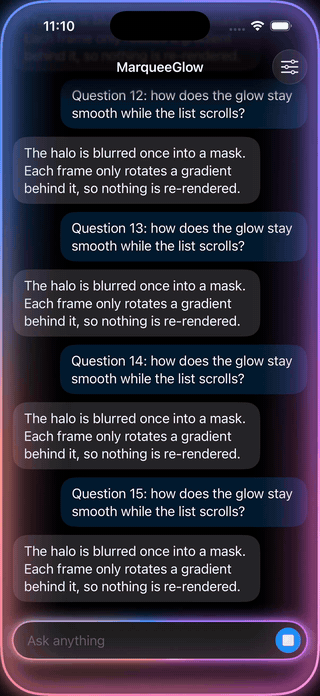
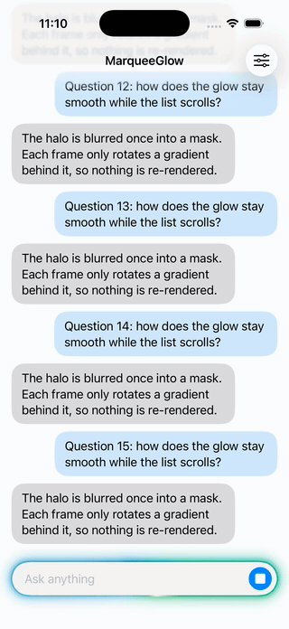

# MarqueeGlow

A SwiftUI modifier that sends a band of color around a view's rounded edge, with a soft halo and a highlight that
brightens the edge as the band passes. Use it on a text field while an AI reply is generating, on a card that is
being worked on, or along the screen edge.

| Dark | Light |
| --- | --- |
|  |  |

It runs at a steady 60 fps while the list underneath scrolls: the halo is blurred once into a mask, and each frame
only rotates a gradient behind that mask. See [Performance](#performance).

## Requirements

- iOS 17+ or macOS 14+
- Swift 6 (the package builds cleanly in the Swift 6 language mode with strict concurrency)

## Installation

Swift Package Manager. In Xcode: **File > Add Package Dependencies…** and enter
`https://github.com/szupzj18/MarqueeGlow`. Or in `Package.swift`:

```swift
dependencies: [
    .package(url: "https://github.com/szupzj18/MarqueeGlow", from: "0.1.0"),
],
targets: [
    .target(name: "MyApp", dependencies: ["MarqueeGlow"]),
]
```

## Usage

```swift
import MarqueeGlow

TextField("Ask anything", text: $text)
    .padding()
    .background(.regularMaterial, in: .capsule)
    .marqueeGlow(isActive: isGenerating, cornerRadius: .infinity)
```

Around the whole screen:

```swift
Color.clear
    .marqueeGlow(isActive: true, colors: .ember, lineWidth: 3, cornerRadius: 55, placement: .inside)
    .ignoresSafeArea()
```

### API

```swift
func marqueeGlow(
    isActive: Bool = true,
    colors: MarqueeGlowColors = .nebula,
    lineWidth: CGFloat = 2,
    cornerRadius: CGFloat = 16,
    placement: MarqueeGlowPlacement = .outside,
    period: Double = 3
) -> some View
```

| Parameter | Meaning |
| --- | --- |
| `isActive` | Shows or hides the glow. It fades in and out over 0.35 s. |
| `colors` | The colors that travel around the edge: a preset, an array literal such as `[.blue, .purple, .pink]`, or `MarqueeGlowColors(light:dark:)` for a separate dark-mode set. |
| `lineWidth` | Width of the sharp band in points. The halo scales with it (about 12 × `lineWidth` outside the view). |
| `cornerRadius` | Match the view's own shape. Values above half the shorter side are clamped, so `.infinity` gives a capsule. |
| `placement` | `.outside` for controls: the halo spreads outward and the view's content stays clear. `.inside` for a container edge such as the screen: everything stays within the bounds. |
| `period` | Seconds per full turn. Changing it restarts the rotation at the new speed. |

Presets, each with a light and a dark variant: `.nebula` (blue, violet, magenta, coral; the default), `.ember`
(red-orange to gold), `.lagoon` (cyan, teal, green) and `.dusk` (indigo, rose, apricot). `MarqueeGlowColors.presets`
lists them with their names for a picker.

### Layers

1. **Band**: a sharp stroke on the edge, colored by a rotating angular gradient.
2. **Halo**: two blurred strokes around it, a narrow bright one and a wide soft one.
3. **Edge highlight**: a short white glint locked to the band that brightens the edge as it passes. It is weaker in
   dark mode, where the halo already adds light.

### Accessibility

- With **Reduce Motion** on, the glow stays still: the same band and halo, no rotation and no moving highlight.
  Showing and hiding it is still a plain fade.
- The glow never takes touches (`allowsHitTesting(false)`) and is hidden from VoiceOver.

### Things to know

- With `.outside` placement the halo extends past the view's bounds. An ancestor that clips (a `ScrollView`,
  `.clipped()`) cuts it off, so leave room around the view or apply the modifier outside the clip.
- Masks are rendered with `ImageRenderer` on the main actor when the view first appears and whenever its size
  changes (a few milliseconds for a text field). The last few sizes are cached.
- There is no public API for the screen's corner radius; 55 pt is close on recent iPhones.

## Example app

`Examples/MarqueeGlowExample` is a small chat screen: send a message and the input bar glows until the made-up reply
arrives. The menu in the top right switches presets and turns on the screen-edge glow. Open
`Examples/MarqueeGlowExample/MarqueeGlowExample.xcodeproj` and run it on a simulator. The project is generated from
`project.yml` with [XcodeGen](https://github.com/yonaskolb/XcodeGen); regenerate it after changing that file.

## Performance

The first version of this effect redrew everything every frame: a `TimelineView` rebuilt the gradient at a new angle
and blurred two strokes the size of the screen. MarqueeGlow blurs once into a mask image and lets SwiftUI's repeating
animation rotate a gradient behind it, so no blur runs while it moves and the view's body is not re-evaluated.

Measured in the example app on an iPhone 17 Pro simulator (Xcode 26.0, Release build, the simulator's 60 Hz cap)
while the chat list scrolls up and down continuously for 10 seconds:

| Scenario | FPS | Hitches | Hitch time | Longest frame |
| --- | --- | --- | --- | --- |
| No glow (baseline) | 60 | 0 | 0 ms/s | 16.7 ms |
| First version, screen edge (`LegacyMarquee`) | 17.8 | 178 | 703 ms/s | 68.6 ms |
| MarqueeGlow, screen edge | 60 | 0 | 0 ms/s | 16.7 ms |
| MarqueeGlow, input bar | 60 | 0 | 0 ms/s | 16.7 ms |

A hitch is a frame that took more than 1.5 × the expected frame time. These are simulator numbers; real devices and
120 Hz ProMotion were not measured. Raw results: `Docs/perf-summary.tsv`. To reproduce:

```sh
Scripts/measure.sh <simulator UDID> /tmp/marquee-perf
```

To let custom animations run at 120 Hz on ProMotion iPhones, add `CADisableMinimumFrameDurationOnPhone = YES` to your
app's Info.plist (the example app does).

## License

MIT. See [LICENSE](LICENSE).
